# ADR graph

Generated from `memory/decisions/`. Do not edit — regenerate with `tools/rebuild-views.sh`.

```mermaid
flowchart LR
  adr_001["ADR-001: Гибридная двухслойная архитектура: Kafka в ядре, NATS на краю"]:::adr
  adr_002["ADR-002: Подтверждение K только после fsync и репликации ×3 по доменам отказа"]:::adr
  adr_003["ADR-003: Ячеистая (cell-based) изоляция отказов"]:::adr
  adr_004["ADR-004: Причинный порядок на гибридных логических часах"]:::adr
  adr_005["ADR-005: At-least-once плюс идемпотентность, transactional outbox"]:::adr
  adr_006["ADR-006: Single-writer для команд K"]:::adr
  adr_007["ADR-007: Резерв под K на 48 ч скользящего окна, независимый от E"]:::adr
  adr_008["ADR-008: Горизонтальные связи: кандидаты NATS gateways и Zenoh, выбор после замера"]:::adr
  cell(["cell"]):::entity
  d_1(["d-1"]):::req
  d_3(["d-3"]):::req
  d_4(["d-4"]):::req
  d_5(["d-5"]):::req
  d_8(["d-8"]):::req
  k_event(["k-event"]):::entity
  node_n1(["node-n1"]):::entity
  node_n2(["node-n2"]):::entity
  node_n3(["node-n3"]):::entity
  p_5(["p-5"]):::req
  p_8(["p-8"]):::req
  platform(["platform"]):::entity
  r_11(["r-11"]):::req
  r_12(["r-12"]):::req
  r_13(["r-13"]):::req
  r_14(["r-14"]):::req
  r_15(["r-15"]):::req
  r_16(["r-16"]):::req
  r_17(["r-17"]):::req
  r_18(["r-18"]):::req
  r_2(["r-2"]):::req
  r_3(["r-3"]):::req
  r_4(["r-4"]):::req
  r_5(["r-5"]):::req
  r_6(["r-6"]):::req
  r_7(["r-7"]):::req
  replication(["replication"]):::entity
  tech_kafka(["tech-kafka"]):::tech
  tech_mirrormaker2(["tech-mirrormaker2"]):::tech
  tech_nats_jetstream(["tech-nats-jetstream"]):::tech
  tech_pulsar(["tech-pulsar"]):::tech
  tech_redpanda(["tech-redpanda"]):::tech
  tech_zenoh(["tech-zenoh"]):::tech
  tension_1(["tension-1"]):::tension
  tension_3(["tension-3"]):::tension
  tension_5(["tension-5"]):::tension
  tension_6(["tension-6"]):::tension
  tension_7(["tension-7"]):::tension
  tension_8(["tension-8"]):::tension
  tension_9(["tension-9"]):::tension
  x_1(["x-1"]):::req
  adr_001 -->|реализует| d_1
  adr_001 -->|реализует| d_8
  adr_001 -->|затрагивает| node_n1
  adr_001 -->|затрагивает| node_n2
  adr_001 -->|затрагивает| node_n3
  adr_001 -->|реализует| p_8
  adr_001 -->|затрагивает| platform
  adr_001 -->|использует| tech_kafka
  adr_001 -->|использует| tech_nats_jetstream
  adr_001 -->|использует| tech_pulsar
  adr_001 -->|использует| tech_redpanda
  adr_001 -->|реализует| x_1
  adr_002 -->|зависит от| adr_001
  adr_002 -->|затрагивает| k_event
  adr_002 -->|реализует| p_5
  adr_002 -->|реализует| r_13
  adr_002 -->|реализует| r_15
  adr_002 -->|реализует| r_3
  adr_002 -->|затрагивает| replication
  adr_002 -->|использует| tech_kafka
  adr_002 -->|использует| tech_nats_jetstream
  adr_002 -->|использует| tech_redpanda
  adr_002 -->|снимает напряжение| tension_1
  adr_003 -->|зависит от| adr_001
  adr_003 -->|затрагивает| cell
  adr_003 -->|реализует| d_3
  adr_003 -->|реализует| d_4
  adr_003 -->|реализует| d_5
  adr_004 -->|зависит от| adr_001
  adr_004 -->|затрагивает| platform
  adr_004 -->|реализует| r_11
  adr_004 -->|реализует| r_12
  adr_004 -->|реализует| r_5
  adr_004 -->|снимает напряжение| tension_3
  adr_005 -->|зависит от| adr_001
  adr_005 -->|затрагивает| k_event
  adr_005 -->|реализует| p_8
  adr_005 -->|реализует| r_16
  adr_005 -->|реализует| r_4
  adr_005 -->|использует| tech_mirrormaker2
  adr_005 -->|снимает напряжение| tension_5
  adr_006 -->|зависит от| adr_002
  adr_006 -->|затрагивает| k_event
  adr_006 -->|реализует| r_17
  adr_006 -->|реализует| r_18
  adr_006 -->|снимает напряжение| tension_8
  adr_006 -->|снимает напряжение| tension_9
  adr_007 -->|зависит от| adr_002
  adr_007 -->|затрагивает| k_event
  adr_007 -->|затрагивает| node_n1
  adr_007 -->|затрагивает| node_n2
  adr_007 -->|затрагивает| node_n3
  adr_007 -->|реализует| r_14
  adr_007 -->|реализует| r_6
  adr_007 -->|реализует| r_7
  adr_007 -->|снимает напряжение| tension_6
  adr_008 -->|зависит от| adr_001
  adr_008 -->|реализует| d_1
  adr_008 -->|затрагивает| node_n1
  adr_008 -->|затрагивает| node_n2
  adr_008 -->|реализует| r_2
  adr_008 -->|использует| tech_nats_jetstream
  adr_008 -->|использует| tech_zenoh
  adr_008 -->|снимает напряжение| tension_7
  classDef adr fill:#dbeafe,stroke:#1d4ed8;
  classDef tech fill:#dcfce7,stroke:#15803d;
  classDef req fill:#fef9c3,stroke:#a16207;
  classDef tension fill:#fee2e2,stroke:#b91c1c;
  classDef entity fill:#f3e8ff,stroke:#7e22ce;
```

## Рёбра

- `adr-001` —реализует→ `d-1`
- `adr-001` —реализует→ `d-8`
- `adr-001` —затрагивает→ `node-n1`
- `adr-001` —затрагивает→ `node-n2`
- `adr-001` —затрагивает→ `node-n3`
- `adr-001` —реализует→ `p-8`
- `adr-001` —затрагивает→ `platform`
- `adr-001` —использует→ `tech-kafka`
- `adr-001` —использует→ `tech-nats-jetstream`
- `adr-001` —использует→ `tech-pulsar`
- `adr-001` —использует→ `tech-redpanda`
- `adr-001` —реализует→ `x-1`
- `adr-002` —зависит от→ `adr-001`
- `adr-002` —затрагивает→ `k-event`
- `adr-002` —реализует→ `p-5`
- `adr-002` —реализует→ `r-13`
- `adr-002` —реализует→ `r-15`
- `adr-002` —реализует→ `r-3`
- `adr-002` —затрагивает→ `replication`
- `adr-002` —использует→ `tech-kafka`
- `adr-002` —использует→ `tech-nats-jetstream`
- `adr-002` —использует→ `tech-redpanda`
- `adr-002` —снимает напряжение→ `tension-1`
- `adr-003` —зависит от→ `adr-001`
- `adr-003` —затрагивает→ `cell`
- `adr-003` —реализует→ `d-3`
- `adr-003` —реализует→ `d-4`
- `adr-003` —реализует→ `d-5`
- `adr-004` —зависит от→ `adr-001`
- `adr-004` —затрагивает→ `platform`
- `adr-004` —реализует→ `r-11`
- `adr-004` —реализует→ `r-12`
- `adr-004` —реализует→ `r-5`
- `adr-004` —снимает напряжение→ `tension-3`
- `adr-005` —зависит от→ `adr-001`
- `adr-005` —затрагивает→ `k-event`
- `adr-005` —реализует→ `p-8`
- `adr-005` —реализует→ `r-16`
- `adr-005` —реализует→ `r-4`
- `adr-005` —использует→ `tech-mirrormaker2`
- `adr-005` —снимает напряжение→ `tension-5`
- `adr-006` —зависит от→ `adr-002`
- `adr-006` —затрагивает→ `k-event`
- `adr-006` —реализует→ `r-17`
- `adr-006` —реализует→ `r-18`
- `adr-006` —снимает напряжение→ `tension-8`
- `adr-006` —снимает напряжение→ `tension-9`
- `adr-007` —зависит от→ `adr-002`
- `adr-007` —затрагивает→ `k-event`
- `adr-007` —затрагивает→ `node-n1`
- `adr-007` —затрагивает→ `node-n2`
- `adr-007` —затрагивает→ `node-n3`
- `adr-007` —реализует→ `r-14`
- `adr-007` —реализует→ `r-6`
- `adr-007` —реализует→ `r-7`
- `adr-007` —снимает напряжение→ `tension-6`
- `adr-008` —зависит от→ `adr-001`
- `adr-008` —реализует→ `d-1`
- `adr-008` —затрагивает→ `node-n1`
- `adr-008` —затрагивает→ `node-n2`
- `adr-008` —реализует→ `r-2`
- `adr-008` —использует→ `tech-nats-jetstream`
- `adr-008` —использует→ `tech-zenoh`
- `adr-008` —снимает напряжение→ `tension-7`
